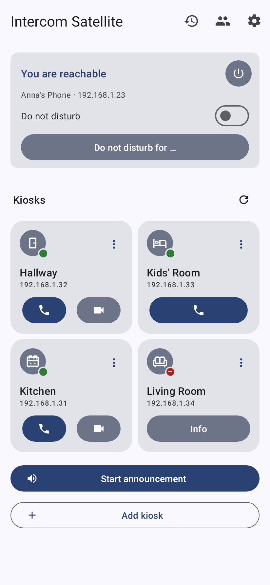
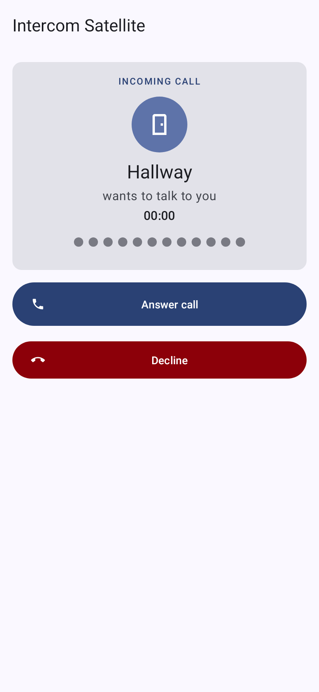
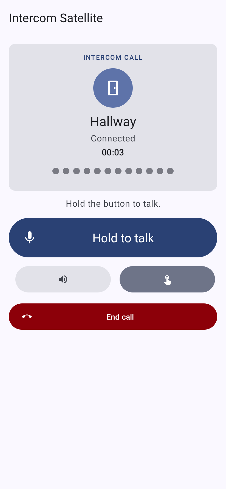
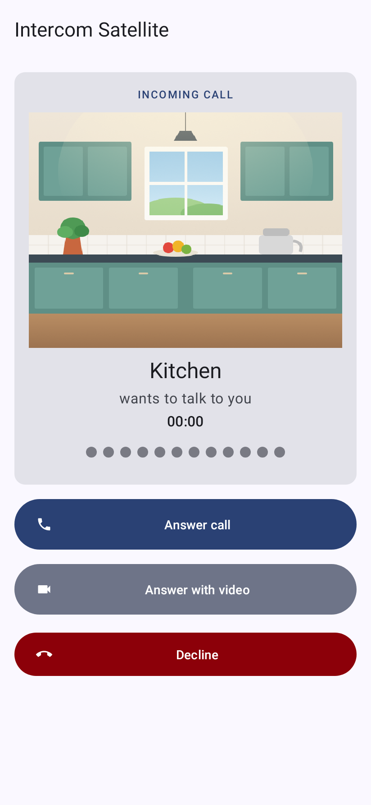
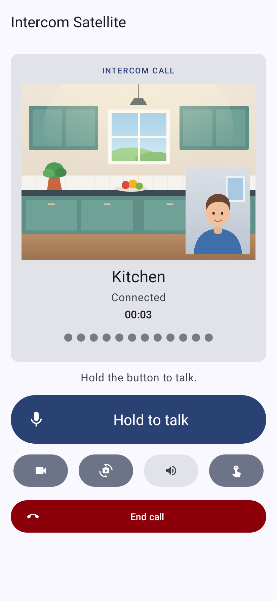
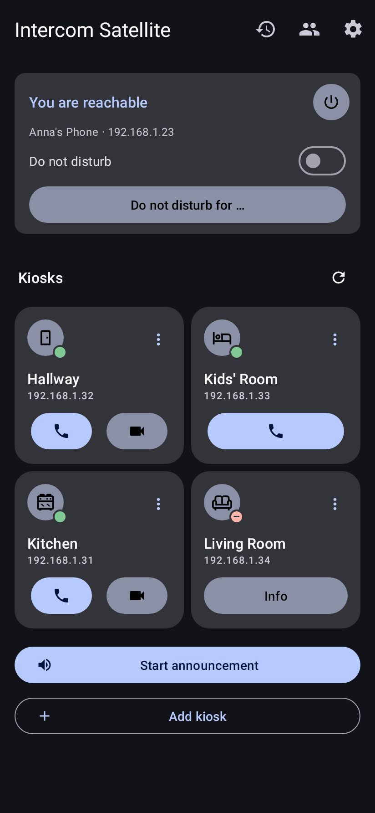

# Intercom Satellite

An Android intercom for [Kiosk Satellite](https://github.com/jxlarrea/kiosk-satellite). Call your kiosks from your phone, take their calls in Android's own phone app, see who is at the door on video, and make announcements to several rooms at once.

Intercom Satellite is an independent companion and not affiliated with Kiosk Satellite.

Calls stay on your local network: no cloud and no account, and nothing is recorded. Android 12 or later.

## Screenshots

| Kiosks | Incoming call | In a call |
|---|---|---|
|  |  |  |
| **Incoming video call** | **Video call** | **Dark theme** |
|  |  |  |

The kiosks in the screenshots are simulated, and the pictures are drawings.

## Features

**Calls**
- Call any kiosk on the network and take its calls, two-way, with push-to-talk or hands-free.
- Incoming calls ring in Android's phone app through its own calling account, also when the phone is locked.
- Call audio goes to a connected Bluetooth or wired headset by itself, and the headset's button answers and ends calls.
- The phone vibrates while a call rings (not in silent mode), and the screen turns off while you hold the phone to your ear.

**Video**
- Video calls with kiosks that support them: see the kiosk's camera and, once you tap, send your own.
- Switch between the front and back camera during the call.
- Leave the app and the kiosk's picture stays on screen in a picture-in-picture window.
- Works in the app's call screen and, through Android's video calling API, in phone apps that show video.
- Three quality levels, from 640 × 480 at 15 fps to 1280 × 720 at 30 fps.

**Announcements**
- Speak to all kiosks, a one-time choice, or a saved room group, and see each room's status.
- One kiosk that fails or declines does not end the others.
- A home-screen widget starts an announcement to all kiosks or a room group with one tap.
- Incoming announcements can be turned off while calls still ring.

**Your kiosks**
- Kiosks are found on the network by themselves; others can be added by address.
- Tiles show every kiosk at a glance, two or three to a row, with Call and Video buttons.
- Names, room icons and favorites per kiosk.
- A ringtone for the app and one per kiosk, when calls ring in the app rather than in Android's phone app.
- A home-screen widget per kiosk with Call and Video buttons and the kiosk's status: online, Do not disturb or offline. Kiosks are checked every 20 seconds, so a change can take that long to show.
- Long-press the app icon to call your favorite kiosks straight away.

**Quiet times**
- Do not disturb, open-ended or for 30 minutes, two hours or until tomorrow morning.
- Weekly quiet hours, also across midnight, with kiosks that may still ring.
- A Quick Settings tile turns Do not disturb on and off.
- Optionally follows Android's own Do not disturb, so kiosk calls stay quiet with the rest of the phone.

**And**
- Call history with callback, and a notification for missed calls with a Call back button.
- Material You design that follows your wallpaper's colors, in light, dark or the system's mode, with a themed app icon.
- Settings move to a new phone with Android's backup: names, room icons, favorites, room groups and quiet hours. The shared key is entered again.
- Settings export to a file and import from one, shared key included, for a second phone or a fresh install.
- English and German.
- Optional TLS with confirmed certificate fingerprints; the intercom key is kept in Android Keystore.

## Setup

1. Install the signed APK.
2. On each kiosk, turn on **Remote Administration**, **Find other kiosks** and **Intercom** in Kiosk Satellite, and copy its intercom key.
3. In the app, open **Settings** and enter the same key.
4. Once the intercom runs, the app asks for background reception, offers the phone account to take kiosk calls in the phone app, and asks to show calls on the lock screen. Anything you skip stays in Settings.

The full guide is in [docs/Setup.md](docs/Setup.md).

## Building

Requires JDK 17 and Android SDK 36; the Gradle wrapper fetches Gradle itself.

```
./gradlew testDebugUnitTest assembleRelease
```

The release APK is unsigned; sign it with your own key, and sign every update with the same key.

## Releases

Pushing a tag that matches the app's version, such as `v1.0.0`, makes GitHub Actions build, test and lint the app and publish a GitHub release with the APK. It is signed when the repository has these secrets, and unsigned otherwise:

- `KEYSTORE_BASE64`: the keystore, as `base64 -w0 release.jks`
- `KEYSTORE_PASSWORD`
- `KEY_ALIAS` and `KEY_PASSWORD`, only when the keystore holds several keys or the key has its own password

## Protocol

Intercom Satellite speaks the [Kiosk Satellite intercom protocol](https://kiosksatellite.com/docs/intercom/): discovery over mDNS (`_kiosk-satellite._tcp`), HMAC-SHA256 tokens, PCM16 16 kHz audio over WebSockets, and H.264 video over a separate per-call WebSocket with per-frame acknowledgements.

## Credits

- [Intercom Pocket](https://github.com/Eibelucas/intercom-pocket) by Eibelucas, the app this project grew out of. Its protocol implementation, phone-app integration, announcements, room groups and quiet hours are the foundation Intercom Satellite builds on. Thank you!
- [Kiosk Satellite](https://github.com/jxlarrea/kiosk-satellite) by Xavier Larrea, the kiosk app and intercom protocol this app talks to.
- [Material Design Icons](https://pictogrammers.com/library/mdi/) by Pictogrammers for the room icons, [Material Icons](https://fonts.google.com/icons) by Google for the other icons, and the GitHub mark from [Octicons](https://primer.style/octicons/) by GitHub.
- [NanoHTTPD](https://github.com/NanoHttpd/nanohttpd), [OkHttp](https://square.github.io/okhttp/) and [Material Components for Android](https://github.com/material-components/material-components-android).

Licenses of the bundled libraries: [THIRD-PARTY-NOTICES.txt](THIRD-PARTY-NOTICES.txt).

## License

[Apache License 2.0](LICENSE); see [NOTICE](NOTICE) for attribution. The bundled libraries and icons keep their own licenses, listed in [THIRD-PARTY-NOTICES.txt](THIRD-PARTY-NOTICES.txt).
